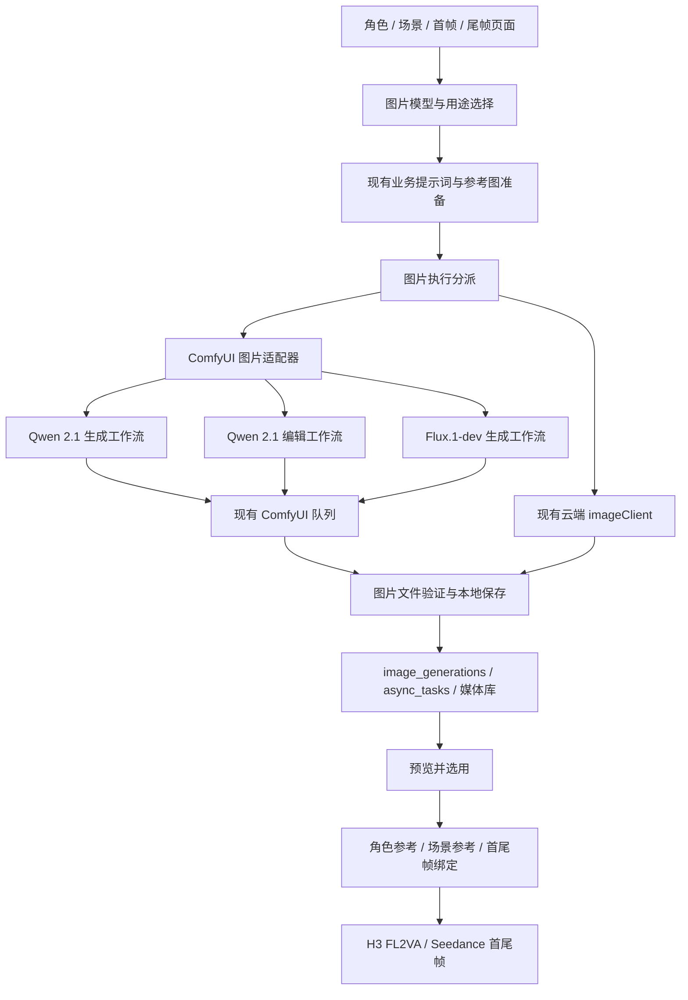

# LocalMiniDrama 本地图片架构更新计划：Qwen-Image 2.1 + Flux

日期：2026-10-01。

状态：2026-10-09 已按计划完成 P0/P1/P2 和 P4 的工程接入及离线验证。P3 真实生图、P4 双段视频质量验证留待用户安排。使用说明与验证边界见 [本地图片接入说明](../local-images.md)。保留原工作区修改和素材，不自动提交、推送或启动长时间生成。

## 1. 更新目标与范围

在当前工程中加入与 MiniMax H3 类似的可选本地图片能力，通过现有 ComfyUI 运行：

- 本地 Qwen-Image 2.1：人物、场景、首帧生成，以及使用参考图编辑尾帧。
- 本地 Flux.1-dev：人物与场景设计、首帧，以及文本描述的独立尾帧候选。
- 保留现有云端图片模型选择。生成的图片进入现有历史、媒体库、角色/场景关联和首尾帧绑定流程。
- 已确认的首尾帧可供 Seedance 使用，并为 H3 接入双图 FL2VA 打通素材路径。

第一版不加入 Z-Image、Qwen Edit 2511、Flux Kontext/Flux.2、身份 LoRA 训练、视频换脸、超分平台或新的任务调度框架。H3 首尾帧接入属于本计划的最后阶段；H3 Turbo 与 SeedVR2 质量优化单独验收，不混入图片接入的完成标准。

不承诺仅通过架构接入即可完全保脸、保动作或达到 Seedance 质量。生成图片、图片间的一致性和最终视频质量分别验收。

## 2. 当前工程事实与复用点

| 当前模块 | 已有能力 | 本次需要补齐 |
|---|---|---|
| `imageService.js` | 分镜图片任务、参考图组装、尾帧首帧站位锁、历史与本地保存 | 在云端配置选择前识别本地模型，使用本地能力限制和图片结果 |
| `imageClient.js` | 云端图片协议；`createAndGenerateImage()` 创建角色/场景图片任务与历史 | 接入统一的图片执行分派，保留现有云端协议处理 |
| `characterLibraryService.js`、`sceneService.js` | 角色/场景提示词与业务入口，调用 `createAndGenerateImage()` | 传递本地模型选择、参考图、LoRA 和候选图片的使用方式 |
| `image_generations` | 已有角色、场景、分镜关联、尺寸、参考图、任务、历史字段 | 补齐本地任务 ID、实际参数快照、seed 和耗时 |
| `storyboardFrameBinding.js` | 首尾帧分别绑定，不用尾帧覆盖首帧字段 | 复用绑定函数，补充用户选用与连续镜头验证 |
| `tailFrameLinkService.js` | 已有尾帧衔接业务入口 | 核对并复用，避免另建第二套尾帧关联机制 |
| `comfyVideoProvider.js` | 上传、队列、历史、进度、下载与取消协议 | 提取少量公共通信函数；视频映射、MP4 检查仍由视频适配器负责 |
| 现有前端任务同步 | 生图任务轮询、错误与历史展示 | 统一显示本地排队、运行、完成、失败和取消状态 |

当前 `/images` 与角色/场景生成不是同一条创建路径：分镜主要通过 `imageService.create()`，角色与场景通过 `imageClient.createAndGenerateImage()`。实施必须同时覆盖，不能只修改 `/images`。

当前图片执行会先查询云端 AI 配置。本地选择应提前分流，避免出现“已配置 ComfyUI 仍报未配置图片模型”。本地 URL 不作为 OpenAI `/images/generations` 地址使用。

## 3. 模型与工作流职责

| 可选项 | 人物 / 场景 | 分镜首帧 | 分镜尾帧 | 参考图能力 |
|---|---|---|---|---|
| 本地 Qwen-Image 2.1 | 文生图或参考图编辑 | 组合角色、场景参考生成 | **推荐从已选首帧编辑生成** | 按实际导出的编辑 Mapping 限制数量与顺序 |
| 本地 Flux.1-dev | 文生图；可选择对应角色的已有 LoRA | 文生图与角色 LoRA 辅助 | 可生成独立候选，需人工检查一致性 | 当前模板没有参考图编辑，不能默默丢弃参考图 |
| 现有云端图片模型 | 继续按原模型能力 | 继续按原模型能力 | 继续按原模型能力 | 保留各云端模型原有限制 |

推荐组合：Flux 建立人物/场景形象 → 用户选定角色参考与场景参考 → Qwen 生成分镜首帧 → Qwen 基于首帧编辑尾帧 → 用户选用 → 本地 H3 或云端 Seedance。

人物和场景可以全部使用 Qwen，也可以全部使用 Flux 文生图；不要强制用户使用固定组合。需要首尾帧一致性时，默认推荐 Qwen 编辑。选择 Flux 且请求参考图编辑时，明确提示当前能力不支持，并让用户改选 Qwen，不能自动换成云端模型。

现有源工作流：

- `E:\ComfyUI-Files\user\default\workflows\【Qwen Image 2.1】图像生成大合集.json`
- `E:\ComfyUI-Files\user\default\workflows\qwen_image_2_1_Q8_0_t2i.json`
- `E:\ComfyUI-Files\user\default\workflows\文+自动提示词-自动生图-Flux1Dev.json`
- `E:\ComfyUI-Files\user\default\workflows\首尾帧-MiniMaxH3-AutoVideo.json`

Qwen 合集中存在被禁用的生成/单图编辑分支和启用的多图编辑分支；Flux 中存在禁用的备用分支。导出时必须追踪实际执行接线、禁用状态和参数覆盖，不能把全部节点直接拼进 API 图。

此前检查显示 Qwen 的 GGUF Q8、Qwen3-VL 8B 编码器、VAE 与编辑节点可用，但一些 BF16 和本地提示词改写权重缺失。Flux 现有身份 LoRA 不一定对应本片角色。实施开始时重新核对实际安装状态。

## 4. 目标架构



分派只负责选择执行路径。角色/场景/分镜的意图和参考图继续由现有业务模块准备；云端协议继续留在 `imageClient.js`。公共 ComfyUI 通信不包含模型特定的提示词、采样参数和输出判断。

### 4.1 工作流与 Mapping

新增三个最小 API 图及对应 Mapping：

```text
backend-node/configs/workflows/
  qwen_image_21_t2i.json            + qwen_image_21_t2i.mapping.json
  qwen_image_21_edit.json           + qwen_image_21_edit.mapping.json
  flux1_dev_t2i.json               + flux1_dev_t2i.mapping.json
```

Mapping 包含：工作流标识与版本、源图摘要、prompt、seed、尺寸、参考图槽位及顺序、可配置 LoRA、模型加载节点、输出节点、支持的用途/模式与尺寸步长。采样参数以实际模板为准，不把 H3 的 FPS 或帧数约束套用到图片模型。

从本地源工作流复制导出，保留原文件。移除任务无关的风格/动作 LoRA 与本地自动提示词分支，使用现有已安装权重。角色 LoRA 由用户选择，默认关闭；记录文件与强度，不能默认把所有人物生成成已有 LoRA 的同一个人。

Qwen 生成与编辑分成两张图，避免提交时依靠复杂旁路开关。编辑参考图上限从模板实际槽位确定；超过时明确报错，不能静默截断后丢失人物或场景参考。

### 4.2 模型选择与配置

新增图片模型键：`auto`、`local:qwen-image-2.1`、`local:flux1-dev`，并以明确的云端配置 ID 关联现有云端选项，避免同名模型选错配置。

选择优先级：本次请求的明确选择 → 项目按用途保存的默认选择 → 原有云端默认配置。旧项目未设置本地模型时继续沿用原默认行为。

项目默认用途分为人物、场景、分镜首帧、分镜尾帧；保存在已有 `dramas.metadata` 的独立键中。全局本地图片参数使用现有设置读写机制保存，不新增一套配置数据库。

复用 H3 当前使用的 ComfyUI 地址，图片参数另存默认尺寸、超时与工作流配置。UI 提供节点/权重检查。检查必须覆盖 Qwen 生成、Qwen 编辑、Flux 三条实际执行分支；本地模型不要求图片 API Key。

提示词优化仍可使用现有文本服务。界面和历史区分“本地图片生成”与“使用云端文本优化”，不能因为图片在本地生成就声称整个任务完全离线或全部免费。

### 4.3 请求与结果

保留现有接口与旧字段，增量增加 `image_model_key`、`generation_mode`、`seed`、`workflow_key`、LoRA 选择以及结果使用方式。首尾帧继续用现有 `frame_type`。

参考图片优先通过现有媒体记录 ID/本地媒体路径传递，记录每张图的角色或场景用途。文件校验包含存在性、图片类型、大小、项目/素材关联和存储目录范围。

本地结果使用 `local_path` 与 `/static/` 地址进入同一历史，不依赖临时 ComfyUI 文件名。完成前检查图片可解码、实际宽高正确，再保存成功状态；已经完成的记录不得随后被迟到的轮询写回失败。

两条现有任务入口使用共同的本地执行和结果处理函数。本地文件直接保存/复制到项目存储，不能走只接受远端 URL 的下载分支。保留现有角色四视图、场景宫格和首尾帧绑定逻辑，并按能力限制显示相应选项。

### 4.4 数据与历史

复用 `image_generations`，通过 `ensureColumns()` 做增量迁移。建议新增：

| 字段 | 用途 |
|---|---|
| `engine`、`model_key` | 明确本地/云端与用户选择的模型 |
| `workflow_key`、`workflow_version` | 定位实际执行的工作流 |
| `seed` | 保存实际随机种子，前端限制为可精确表示的整数 |
| `provider_task_id` | 保存 ComfyUI prompt ID，支持查询/取消/恢复 |
| `generation_elapsed_seconds` | 保存已确认的实际执行耗时 |
| `generation_metadata` | 实际权重/LoRA、参数、参考图角色与摘要、编译后提示词、排队/分段耗时、结果使用方式 |

现有 `provider`、`model`、`generation_mode`、width/height 与目标实体 ID 继续使用。旧记录不推断未知种子或耗时，不伪造工作流版本。

本地图片来源标记为 local/ComfyUI，不伪造方舟原生生成或已认证来源；后续给云端视频使用时继续经过现有上传和素材来源校验。

新增元数据同步到项目导入/导出白名单与前端历史响应。图片关联、历史版本与首尾帧绑定能往返恢复，不能只在当前机器数据库里可见。

## 5. 人物、场景与首尾帧流程

### 人物

在已有角色上生成形象候选，不重新抽取或覆盖角色文字设定。用户选定正面参考，再通过 Qwen 编辑生成侧面/其他角度候选；实际使用的角色身份 LoRA 明确关联该角色。新增图片进入角色历史与素材库，已有选定主图通过显式“设为人物参考”切换。

### 场景

Qwen 与 Flux 都可生成场景候选。选定基础场景后，Qwen 可基于场景参考编辑机位/光线变化。保存场景来源与参考关系；分镜继续引用已有 scene ID，不把同一场景的每张变体都建成新场景实体。

### 首帧

组合已选角色参考、场景参考、分镜机位和开场姿态，通过 Qwen 编辑/生成输出；Flux 通过文字与正确角色 LoRA 输出独立候选。用户预览后绑定到现有 `first_frame_image_id`。

### 尾帧

Qwen 编辑输入以该分镜已选首帧为画面基础，并保留固定人物参考和必要的场景参考；描述同一镜头结束时的动作、位置、视线、手部接触和合理机位变化。首帧、尾帧保持相同画幅。

结果预览后绑定现有 `last_frame_image_id`。本地生成的新候选不自动覆盖已选首尾帧或角色/场景主图；旧云端自动使用行为保持兼容，需要在结果处理处区分使用方式。

同一连续镜头延长时，下一段首帧优先复用上一段实际输出尾帧，结合固定人物参考编辑下一段目标尾帧。换机位的剪辑镜头保持人物、方向和空间关系，不强制边界像素相同。既有 tail-link 能力先检查再复用。

## 6. 前端可选本地的产品行为

新增可复用 `ImageModelSelector.vue`，用于角色、场景、首帧、尾帧与自由生图入口：

- 显示“跟随默认 / 本地 Qwen-Image 2.1 / 本地 Flux.1-dev / 已配置云端模型”。
- 支持项目用途默认值与本次请求覆盖；批量入口使用同样的选择规则。
- 选择本地时显示连接/工作流可用状态、尺寸、seed、参考图和可选角色 LoRA。
- 尾帧编辑默认提示使用 Qwen；Flux 的独立候选与参考图编辑能力清楚区分。
- 生成结果可预览、重试、选用、设为人物/场景参考、设为首帧/尾帧；保留旧结果和实际模型来源。
- 图片和 H3 视频共享 ComfyUI 队列信息；排队与生成耗时分开显示，未实测时不显示虚构剩余时间。

需覆盖 `FilmCreate.vue` 与其角色/场景 composable、`DramaDetail.vue`、`useCanvasAssetGenerate.js`、`useCanvasWorkflowRunner.js`，以及已有 `FreeCreate.vue`/通用图片入口。节点画布、批量生成和普通页面不能选了本地后又丢失参数。

## 7. 队列与现实错误处理

复用 ComfyUI 自身队列，12G/16G 单卡图片与视频顺序执行，不默认并行加载多个大模型。第一版不新增第二个 GPU 调度系统，不自动重启 ComfyUI 或强制清空别人的任务。

提交后保存 prompt ID；排队超时与实际执行超时分别管理。超时不等于任务已取消，保留继续查询入口。后端重启后凭已保存 ID 查询 ComfyUI 队列/历史；找不到时明确报告任务丢失，不重复提交。

取消仅针对本工程该条记录。待执行任务删除自己的 ID；运行中仅在确认全局 interrupt 不会伤及其他任务时调用。图片任务应接入已有取消入口，不能只更改数据库状态而让显卡继续生成。

处理 Offline、缺节点/权重、参考图缺失或超限、OOM、任务取消/丢失、输出节点无图片、输出损坏等情况。失败保留参数与错误记录，不自动改用云端图片或云端视频，不静默降分辨率、换模型或自动重试。

## 8. 按依赖分阶段实施与验证

| 阶段 | 可交付内容 | 验证与完成条件 |
|---|---|---|
| P0：基线与导出 | 确认当前改动、三张图片 API 图和 Mapping、节点/权重清单 | 导出图无无关分支/私人提示词；实际参数覆盖正确；参考图与输出槽位检查通过；保留原工作流 |
| P1：后台本地图片 | 图片模型选择、公共 Comfy 通信、图片适配、增量迁移、两条图片入口接入 | Mock ComfyUI 覆盖提交/排队/历史/下载/损坏/取消；本地不依赖云端图片 Key；H3 原测试通过；旧数据库与旧云端调用不退化 |
| P2：界面与素材闭环 | 各入口模型选择、任务状态、图片预览选用、项目默认值、历史与导入/导出 | 前端请求传递完整；角色/场景/首尾帧均进入同一历史；尾帧不会覆盖首帧；用户选用前保留原资产；构建通过 |
| P3：本机图片验证 | 固定人物/场景的 Qwen 文生图、Qwen 编辑、Flux 文生图样本 | 用户安排运行时逐张生成并保存实际尺寸/seed/耗时/错误；检查脸、发长、衣服、位置、机位与手部；编辑尾帧确实使用首帧输入；结果进入工程可预览和选用 |
| P4：首尾帧视频衔接 | H3 双图 FL2VA 接入；Seedance 沿用已有首尾帧构造；实际输出尾帧衔接下一段 | 独立测试项目验证两段连续动作；完整播放检查中间脸与动作；H3模式/提示词/缓存包含尾帧；云端试验另经现有费用确认；原分镜/已选视频不被测试覆盖 |

P1/P2 普通验证命令沿用仓库：后端 `node --test test/*.test.js`，前端 `node --test test/*.test.js`，前端 `npm run build`。先精准测试，再完整回归。文档与配置计划本身不触发 GPU 验证。

真实生成逐步进行，不在工程启动、连接检查、迁移或页面打开时自动运行。第一版默认 batch=1，不承诺固定耗时。5060 Ti 16G 后续用相同输入和参数复测，单独记录结果。

## 9. 预计影响文件

新增建议：`comfyClient.js`（公共协议）、`comfyImageProvider.js`（图片执行与验证）、`imageModelSelection.js`（选择与能力），以及三个图片 API 图/Mapping、前端 `ImageModelSelector.vue` 与针对性测试。只有确有模型提示词转换需求时才新增图片 prompt adapter，不建立多余插件框架。

修改范围：

- 后端：`imageService.js`、`imageClient.js`、`characterLibraryService.js`、`sceneService.js`、相关 routes 与 `src/db/migrate.js`；图片结果序列化和项目导入/导出。
- 公共 Comfy 通信提取：`comfyVideoProvider.js` 与其测试，保留 H3 的模型绑定与视频输出规则。
- 首尾衔接阶段：`hybridVideoService.js`、H3 Mapping/模板、`storyboardFrameBinding.js` 与既有 tail-link 相关代码，按实际需要修改。
- 前端：图片 API 请求类型/参数、角色/场景 API，前述普通/画布/批量生成入口及任务/历史显示。
- 文档：更新本地图片配置说明、README 的模型选择与使用步骤、真实验证报告。

不修改构建系统、CI/CD 或现有部署方式；不复制或提交模型权重、API 密钥、原始工作流私人提示词与生成媒体。

## 10. 第一版验收

1. 人物、场景、首帧、尾帧页面可以选择本地 Qwen 或 Flux；不支持的编辑请求明确阻止并说明。
2. 没有云端图片 Key 也可以执行本地图片任务；仍需要文本服务的步骤明确显示其依赖。
3. 生成结果完整进入历史和媒体库，可人工选用并正确关联人物、场景与首尾帧，旧资产可恢复。
4. 本地失败不会发生任何云端兜底调用；取消、查询、错误与重启恢复能追踪到具体任务。
5. 现有云端生图、MiniMax H3、视频费用确认与项目导入/导出回归通过。
6. 工程闭环测试通过与人物一致性/视频效果通过分开记录。未运行 P3/P4 时明确标记真实生成与质量验收待完成。

模型能力依据：[Qwen-Image 2.1 官方说明](https://github.com/QwenLM/Qwen-Image-2.1)、[Flux.1-dev 官方模型说明](https://huggingface.co/black-forest-labs/FLUX.1-dev)、[H3 官方说明](https://github.com/MiniMax-AI/MiniMax-H3)。本计划中的本地工作流能力以已检查接线和实施时的实际验证为准。
